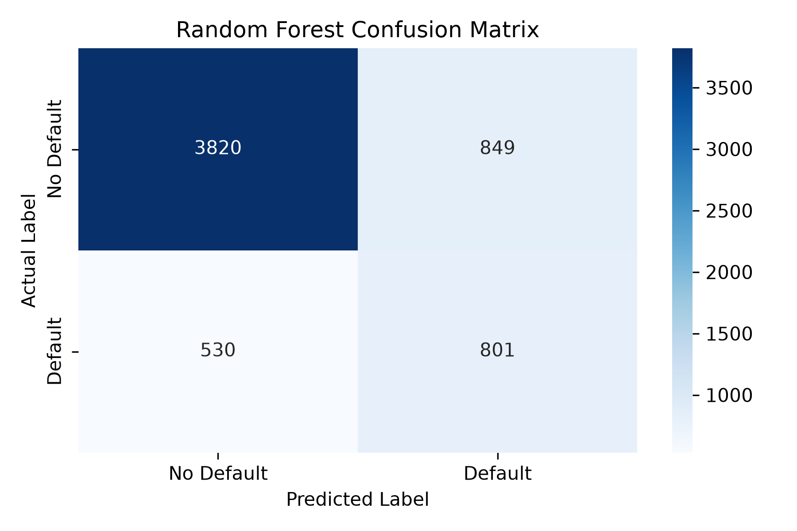
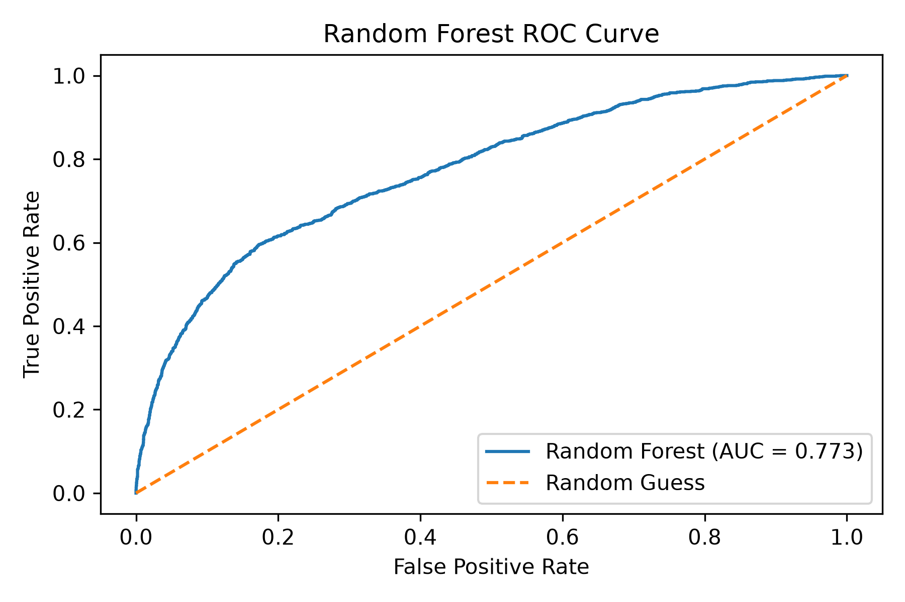
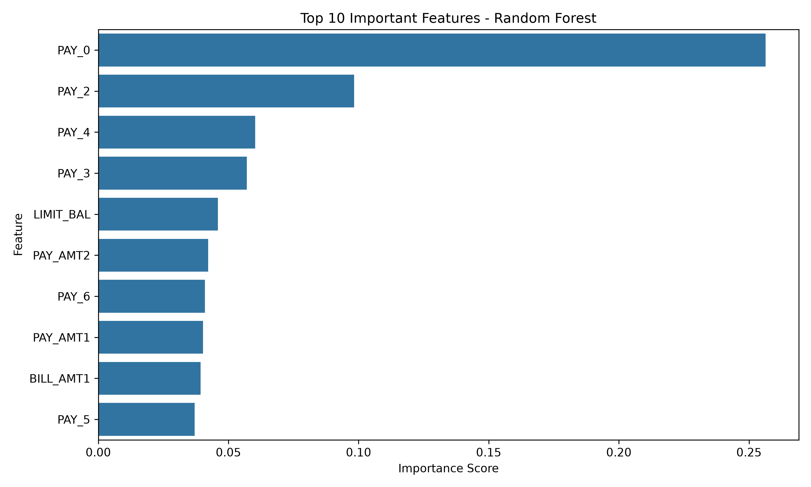

  # Credit Risk Scoring Model

## Project Overview
This project uses machine learning to predict whether a credit card client is likely to default on their payment next month. It compares Logistic Regression and Random Forest models using a real-world credit dataset.

## Objectives
- Predict potential credit card payment defaults.
- Compare machine learning models.
- Evaluate model performance using Accuracy, Recall, F1-score, and ROC-AUC.

## Technologies Used
- Python
- Pandas
- Scikit-learn

## Dataset
The project uses the **Default of Credit Card Clients** dataset from the UCI Machine Learning Repository.

- Total records: 30,000
- Input features: 23
- Target: Default payment next month (0 = No, 1 = Yes)

The dataset file is not included in this repository.

## Machine Learning Models
- Logistic Regression
- Balanced Logistic Regression
- Random Forest Classifier

## Model Performance Comparison

| Model | Accuracy | Class 1 Recall | Class 1 F1-score | ROC-AUC |
|---|---:|---:|---:|---:|
| Logistic Regression | 81.03% | 26.00% | 37.00% | 0.71722 |
| Balanced Logistic Regression | 68.52% | 63.86% | 47.37% | 0.71763 |
| Random Forest (100 trees) | 79.25% | 49.44% | 51.39% | 0.75690 |
| Random Forest (200 trees) | 79.62% | 49.74% | 51.98% | 0.76324 |
| Tuned Random Forest | 77.02% | 60.18% | 53.74% | 0.77335 |

**Note:** Class 1 represents clients who default on their payments. Accuracy alone is not sufficient for evaluating credit risk models, so Recall, F1-score, and ROC-AUC are also considered.
## Current Best Model

**Tuned Random Forest**

- Accuracy: 77.02%
- Class 1 Recall: 60.18%
- Class 1 F1-score: 53.74%
- ROC-AUC: 0.77335

The Tuned Random Forest achieved the highest Class 1 F1-score and ROC-AUC among the evaluated models. It is the preferred candidate for identifying potential payment defaults, although further evaluation is required.

These are previously recorded experimental results and must be verified by rerunning the model before being treated as final results. from the current experimental train-test split and may vary if the data split or model settings change.

## How to Run

1. Install Python.
2. Clone or download this repository.
3. Place the dataset file named `default of credit card clients.xls` in the project folder.
4. Install the required libraries:

   `pip install -r requirements.txt`

5. Run the Python script:

   `python credit_risk_model.py`

**Note:** The dataset is not included in this repository. Ensure that the dataset filename matches the filename expected by the Python script.

## Model Evaluation Visualizations

### 1. Random Forest Confusion Matrix

**Confusion Matrix Results**

| Metric | Value |
|---|---:|
| True Negatives (TN) | 3,820 |
| False Positives (FP) | 849 |
| False Negatives (FN) | 530 |
| True Positives (TP) | 801 |

The confusion matrix summarizes the model's correct and incorrect predictions for both classes on the test dataset.

### 2. Random Forest ROC Curve

### 3. Random Forest Feature Importance

## Feature Importance Analysis

The Random Forest feature importance analysis identifies the most influential features used by the model to predict credit card payment defaults.

- **PAY_0** is the most important feature, with an importance score of approximately 0.256.
- **PAY_2, PAY_4, and PAY_3** are also among the most important features.
- **LIMIT_BAL** (credit limit) and payment amount features also contribute to the model's predictions.

These results suggest that recent and historical payment status information plays an important role in predicting payment defaults. Feature importance indicates relative model contribution and does not establish causation.

## Results Verification

The performance metrics and confusion matrix shown in this README are previously recorded experimental results. They should be verified by rerunning the model and evaluation scripts before being considered final. Results may vary depending on the data split, preprocessing steps, and model configuration.

## Project Status
Ongoing — model evaluation and improvement are in progress.

## Author
Dilini Dissanayake

GitHub: [Dilini8888](https://github.com/Dilini8888)
